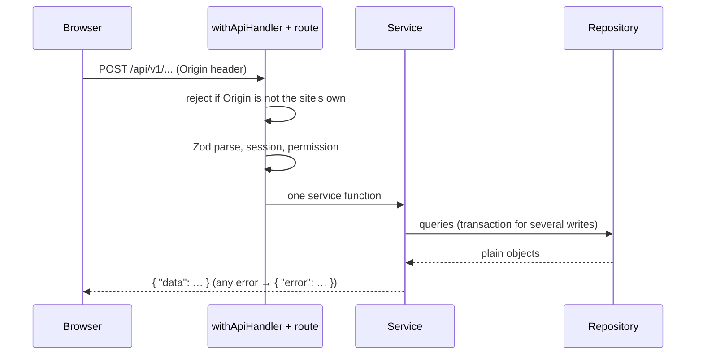

# Architecture

One Next.js application: public website, staff portal (`/portal`) and REST API (`/api/v1`) in the same codebase. All business logic lives in one server-only service layer, so every rule exists in exactly one place.

## Stack and key decisions

| Area       | Choice                                                                                        | Why / consequence                                                                                                                                                              |
| ---------- | --------------------------------------------------------------------------------------------- | ------------------------------------------------------------------------------------------------------------------------------------------------------------------------------ |
| Framework  | Next.js 16.4, App Router, Turbopack, Cache Components on                                      | Data is dynamic by default; public reads opt in to caching                                                                                                                     |
| Language   | TypeScript 6.0 (`strict`, `noUncheckedIndexedAccess`, `noImplicitOverride`)                   | Not 7: `typescript-eslint` supports below 6.1 only. Revisit when it adds support                                                                                               |
| Styling    | Tailwind CSS v4 through `@tailwindcss/postcss`, shadcn/ui on Radix                            | The setup the Next.js docs describe (the starter's `@tailwindcss/turbopack` loader is undocumented)                                                                            |
| Database   | MongoDB 8 + Mongoose 9, as a replica set                                                      | Transactions need a replica set. No Prisma: it does not support MongoDB in its current major version                                                                           |
| Auth       | Better Auth + MongoDB adapter                                                                 | Staff email and password; no public sign-up                                                                                                                                    |
| Validation | Zod 4, shared by forms and API                                                                | One schema validates in the form and again in the API                                                                                                                          |
| Tooling    | npm, Node 24, ESLint 9 (strict type-checked), Prettier, Knip, Husky, Vitest, Playwright + axe | Knip enforces "no unused code"; dependencies are added only when used. ESLint 9, not 10: `eslint-plugin-import` crashes on ESLint 10 whenever it reports an import-order error |
| Logging    | pino                                                                                          | Server only; never logs secrets or personal documents                                                                                                                          |

Later phases add Cloudinary, Nodemailer with React Email, React Hook Form and Turnstile (see the project brief). There is no rich text editor: long text is plain text in a shadcn Textarea, shown by `FormattedText` (open-questions D13).

Decisions with consequences:

- **One service layer and one API.** Every client-side read and write goes through `/api/v1`; there are no Server Actions for data changes. Server Components call services directly and never call the app's own API over HTTP.
- **`mongodb` is a direct dependency** (it is the peer dependency of Better Auth's Mongo adapter), so Mongoose and the adapter share one driver copy and Better Auth can reuse Mongoose's client for transactions.
- **npm** with a committed `package-lock.json`. Install scripts are allow-listed in `package.json` (`allowScripts`): `esbuild` and `mongodb-memory-server` run, `fsevents` does not.
- **shadcn components import `cn` from the `cn` package** (not from `src/lib/utils.ts`). `src/components/ui/` and `src/hooks/use-mobile.ts` are CLI output: ESLint skips them and Knip ignores their unused exports, but Prettier and TypeScript still check them.

## Layers

```text
Client components (portal screens, public forms)
   │  typed API client (apiPost, apiPatch)          (portal saves)
   ▼
Route handlers   src/app/api/v1/**/route.ts        parse → authenticate → authorize → call service → respond
   ▼
Services         src/server/services/*.ts          rules, permissions, transactions, audit log, cache invalidation
   ▼
Repositories     src/server/repositories/*.ts      Mongoose queries only; return plain objects
   ▼
MongoDB          models in src/server/db/models/
```

1. Route handlers parse params and body with Zod, load the session, check the permission, call one service function and return the standard response. No Mongoose in routes, pages or components.
2. Services take a typed context (acting user, role, office) plus validated input. They enforce rules, run multi-document writes in a transaction, write an audit entry per change and invalidate cache tags.
3. Only repositories import Mongoose models. They use `.lean()`, select only needed fields and return plain objects with `id` as a string.
4. Every file under `src/server/` starts with `import "server-only"`.



## HTTP layer

- `withApiHandler()` (`src/server/http/handler.ts`) wraps every route handler. It rejects `POST`, `PUT`, `PATCH` and `DELETE` whose `Origin` is not `NEXT_PUBLIC_SITE_URL`'s origin, and maps typed `AppError`s and Zod errors to the standard format. Unexpected errors are logged and returned as a generic `INTERNAL_ERROR`.
- Success `{ "data": … }` (lists add `"meta": { "page", "pageSize", "total" }`). Error `{ "error": { "code", "message", "details": { "fieldErrors" } } }`.

| Code               | Status | Code                | Status |
| ------------------ | ------ | ------------------- | ------ |
| `VALIDATION_ERROR` | 400    | `CONFLICT`          | 409    |
| `UNAUTHORIZED`     | 401    | `PAYLOAD_TOO_LARGE` | 413    |
| `FORBIDDEN`        | 403    | `RATE_LIMITED`      | 429    |
| `NOT_FOUND`        | 404    | `INTERNAL_ERROR`    | 500    |

- **Connection:** one Mongoose connection cached on `globalThis` (no new connection per hot reload), `sanitizeFilter` on (request input can never inject query operators), `autoIndex` off in production.
- **Caching:** public service reads use `"use cache"` with `cacheLife` and `cacheTag` (settings: tag `settings`, hours), invalidated after writes. **Invalidation:** this app writes through route handlers, where `updateTag` is not available (it works only in Server Actions). A service that changes content calls `revalidateTag(tag, { expire: 0 })` (tags in `src/lib/constants/cache-tags.ts`) after the write commits, so the next page view is a cache miss and staff see their change at once. A component that reads them calls `await connection()` first and sits in a `<Suspense>`, so the data is fetched at request time and `npm run build` never needs a database. Portal data is per-user and never cached on the server.
- **Public pages:** a page is a static shell (banner, header, footer) plus content components that call `await connection()` and a cached service, inside `<Suspense>`. Filters and paging come from URL search params, parsed by `src/lib/validations/list-params.ts` (bad values are ignored). An unknown slug renders the not-found page with `noindex` and status 200, because the shell has already been sent. The header navigation is part of the shell; the highlighted item is a style rule streamed in by `ActiveNavStyle`, because reading the path inside the nav would stream the whole nav after the footer.
- **Environment:** `src/env.ts` validates variables with Zod; `next.config.ts` runs it on every start and build, so the app refuses to run with a bad variable.

## Folder structure

```text
.github/workflows/ci.yml      format, lint, typecheck, knip, tests, build, audit, e2e
.husky/pre-commit             lint-staged
docs/                         five documents, plus reference/ (client files, kept until design sign-off)
public/brand/                 OEDF logos only
scripts/                      seed.ts, sync-indexes.ts
src/
  app/                        (site)/ (layout, home, error), portal/(dashboard)/, api/auth/[...all], api/v1/health, not-found, global-error, layout, globals.css, icons
  components/                 ui/ (shadcn), shared/, site/ (header, footer, cards), portal/
  features/                   one folder per public page group: home, about, governance, departments, programs, institutions, careers, research, news, faqs, contact, admissions, legal
  content/                    typed draft copy (home, about, governance, admissions, legal)
  hooks/                      use-mobile.ts (shadcn)
  lib/                        constants/ (enums, departments, site, navigation, labels, cache-tags), validations/ (list-params), seo, structured-data, og-image, format, query-string, auth-client
  server/
    auth/                     auth.ts (Better Auth), session.ts (requireSession)
    db/                       connection.ts, define-model.ts, models/ (one per collection, all-models.ts, shared.schema.ts)
    http/                     handler.ts, errors.ts, responses.ts
    lib/logger.ts
    repositories/  services/
  env.ts
tests/                        e2e/, global-setup.ts (one in-memory replica set), setup.ts (per-file database)
```

- Used by one feature: `src/features/<feature>/`; by two or more: `src/components/shared/` (generic) or `src/components/site/` (public-site specific, such as cards). `src/components/ui/` holds only shadcn CLI output; change looks through tokens and `cva` variants, or wrap in `shared/`.
- Route files stay short: load data, compose components. Unit tests sit next to the file they test. Alias `@/` is `src/`. No barrel `index.ts` (`all-models.ts` is a list for the index script and its test, not a barrel).
- Only `src/server/storage/cloudinary.ts` talks to the Cloudinary SDK.

## Public forms and security

- **Layers for a form:** the browser validates with the same Zod schema as the API (`src/lib/validations/`), sends JSON through `src/lib/api/client.ts`, and shows server field errors next to the fields. The route handler parses the body, runs the guard, then calls one service function.
- **Guard** (`src/server/security/public-form-guard.ts`): honeypot first, then a per-IP fixed-window rate limit stored in `rateLimits` (the IP only as a hash, a TTL index removes old buckets), then Turnstile. No Turnstile secret key (local development) skips the spam check; a real deployment must set both keys.
- **Email** (`src/server/email/`): Nodemailer plus React Email templates. Sending never throws into the caller.
- **Forms** (`src/components/forms/`): fields built on shadcn `Field` with the description and error linked by `aria-describedby`, an error summary that takes focus and links to each field (react-hook-form's own focus is off), and a hidden honeypot. The multi-step application keeps one form instance, so answers survive Back.
- **Not yet built:** security headers and the Content-Security-Policy (Phase 7).

## Files (Cloudinary)

- **Two kinds of asset.** Public images (news covers, program images) are `upload` assets, delivered through `next/image` with a Cloudinary loader that requests resized copies. Personal documents (CNIC or B-Form copies, result cards, income proof, CVs) are `authenticated` assets: neither the original nor any resized copy can be fetched without a signed link.
- **Staff access** to a personal document uses `private_download_url` with `expires_at` five minutes ahead, created per request after the permission check. `cloudinary.url()` is never used for these files, because its signed URLs do not expire.
- **Strict Transformations is off on purpose.** It would block the resized public images the `next/image` loader requests, and it is not needed to protect personal documents, since authenticated assets already need a signature for every delivery, original or resized. Do not turn it on without changing the image loader.
- **Uploads are always signed.** The server signs each upload with a random public ID and the allowed formats; the size limit (5 MB) is checked before signing and again after the upload; there is no unsigned preset. The folder comes only from `CLOUDINARY_FOLDER` (`oedf-dev` locally, `oedf-preview` on previews, `oedf` in production), so a preview or local build never writes to the production folder.
- **Deleting is restricted.** Public IDs come from the browser, so the server deletes a file only if it is in the folder it signed, still `pending`, and fails the format or size check.
- `globals.css` imports `tw-animate-css` and `shadcn/tailwind.css` (dev dependencies) for the animated shadcn components. The shared gold button is `CtaButton`, a variant wrapper in `shared/`.

## Auth and permissions

Staff sign in with email and password; Better Auth serves `/api/auth/*`. Public sign-up is disabled.

| Setting             | Value                                                                                                                                                                                     |
| ------------------- | ----------------------------------------------------------------------------------------------------------------------------------------------------------------------------------------- |
| Minimum password    | 9 characters (`MIN_PASSWORD_LENGTH`; the client's decision, open-questions D31), also on admin-created accounts (a before-hook adds this: the admin `createUser` only checks the maximum) |
| Sign-in rate limit  | 5 attempts per minute, then `429`                                                                                                                                                         |
| Session cookie      | `HttpOnly`, `SameSite=Lax`, `Secure` in production, 7 days                                                                                                                                |
| Cross-site requests | A request with a session cookie from another origin gets `403`                                                                                                                            |
| Accounts            | Created by Super Admin only; deactivated (banned), never deleted                                                                                                                          |

The cookie is `Secure` in production, so over plain `http://localhost` use Chrome or Firefox (Safari rejects it).

| Role          | Who                                   | Scope                                                                 |
| ------------- | ------------------------------------- | --------------------------------------------------------------------- |
| `SUPER_ADMIN` | Technical administrator               | Everything, including users and settings                              |
| `CEO_OFFICE`  | Prof. Omar Farooq and executive staff | Sees all offices, makes final decisions, reads the audit log          |
| `DIRECTOR`    | Head of one office                    | Full control of their office's modules, publishes, makes decisions    |
| `STAFF`       | Office team member                    | Works on their office's items; cannot publish or make final decisions |

- Each user has one role and one office (`departmentId`). Roles are defined once in `ROLES` (`src/lib/constants/enums.ts`); `auth.ts` registers all four with Better Auth's admin plugin (a compile-time check catches a missing one). Only `SUPER_ADMIN` gets the plugin's admin rights. The seeded Super Admin belongs to the Chief Executive Office.
- **Permissions:** strings such as `applications:review`, `vacancies:publish`, `directives:issue` live in `src/lib/constants/permissions.ts`. One role-to-permission map (`ROLE_PERMISSIONS`) is used by the sidebar, the buttons and the server. A module owned by one office (applications, vacancies, institutions, publications) works only inside that office for Director and Staff; Super Admin and the CEO Office are not tied to an office. Only the Research & Policy Institute may issue directives. Every protected route handler calls `requireApiPermission(request, permission)` and every portal page calls `checkPagePermission(permission)`; a missing permission is a `403` from the API and an in-page "Access denied" view from a page (Next's `forbidden()` is still experimental, so it is not used). `src/proxy.ts` only redirects signed-out visitors away from `/portal` (it looks for the session cookie) and is never a security layer.
- **Portal screens.** Everything is built from shadcn/ui, with no other UI or table library (no TanStack). Lists are Server Components that read paging, filters and `sort` from the URL and render the shared `DataTable` (a shadcn Table with a Columns menu to hide columns). A sortable column header is a link to the new order (`sort=field` or `sort=-field`, back to page 1) with `aria-sort`; filters are a plain GET form (`FilterBar`, `FilterSelect`, `FilterInput` in `components/portal/list-filters.tsx`) whose "All" choice means no filter. List schemas share `listQuerySchema`, `filterEnum`, `filterText`, `filterDate` and `sortParam` (`src/lib/validations/common.ts`); a bad value falls back to the default, so an edited link still opens. Short forms (a status change with its reason, a note) open in a Dialog; saves go through `/api/v1` with `apiPost` / `apiPatch`, then a toast and a page refresh. A record that does not exist shows the portal's not-found view (`orNotFound`).
- **Account actions** (sign-in, password change, name change, session revoke, password reset) are Better Auth's own endpoints; an after-hook writes each to the audit log. Invitations and resets are one flow (`requestPasswordReset`, link valid 24 hours, sessions revoked on reset); the invitation creates the account with a random password nobody knows, so no administrator ever chooses or sees a password.

## Application review

- **One status map** (`APPLICATION_TRANSITIONS`, `src/lib/constants/application-workflow.ts`) decides where an application can go; `permissionForStatus` says that Approved and Rejected need `applications:decide` and every other move `applications:review`. The detail page shows only the moves this person may make; the service checks the same rules again before writing.
- **A move is one conditional write**: it matches the status the page showed (and, for Verified, a complete checklist), so two people acting at once cannot both succeed; the second gets `409`. It records who, when and why in `statusHistory` and the audit log (`application.status_changed`, with from, to and reason). Approving a scholarship creates its award in the same transaction.
- **Privacy:** lists project only the last four CNIC digits in the database query (`$substrCP`), so the full number never leaves MongoDB for a list. The detail page shows it to people who may read applications. Emails to applicants never include staff's internal reason.

## Vacancies and job applications

- **Vacancies:** Staff write drafts; publishing, closing, reopening and editing a published vacancy need `vacancies:publish` (a Director). A long form gets its own page (`/portal/vacancies/new`, and the form on the detail page). The deadline is a day; it is stored as the last moment of that day in Pakistan time, so the public pages and `effectiveVacancyStatus` close it on time without a job. Every change to a published vacancy expires the `vacancies` cache tag. Description and requirements are plain text shown by `FormattedText`.
- **Archiving:** applications and job applications are never deleted. `PATCH /{resource}/{id}` with `{ isArchived }` (the shared `ArchiveButton`) hides one from the default list (`view=ARCHIVED` shows them) and makes it read-only: status moves, the checklist, notes, the interview time and the applicant's document upload are refused with `409` until it is restored. Each archive and restore is audit-logged.
- **Job applications** follow `JOB_APPLICATION_TRANSITIONS` with the same conditional write as applications (`409` when someone changed it first). They are archived, never deleted; an archived one is hidden from the default list and read-only until restored. The CV opens like any private file (`PrivateFileLink`, 5-minute link, audit-logged).
- **Shared portal pieces** added here: `ConfirmButton` (an Alert Dialog before publishing, closing, archiving or deleting), `PrivateFileLink`, `apiDelete`, `buildTimeline` (`src/server/lib/timeline.ts`) for every status-and-notes history, and `escapeRegExp` (`src/server/lib/escape-regexp.ts`) for search text.

## Programs and institutions

- **Who does what:** Staff of Institutional Development create and edit draft programs and non-public institutions, and record agreements and reviews. Publishing a program (any status but Draft), making an institution public, and changing either once it is on the public site need `programs:publish` / `institutions:publish` (a Director). A program nobody applied to can be deleted (a published one by a Director); one with applications is archived. Institutions are never deleted (set Closed).
- **Photos:** staff upload a public `IMAGE` (signed upload, `upload` delivery, tag `pending` until saved) with a required description. `resolveImage` keeps, replaces (checked with Cloudinary) or removes it; `settleImage` confirms the new file and deletes the replaced one. Public pages get a resized link from `toPublicImage` and render it with `next/image`; `next.config.ts` allows only this account's `res.cloudinary.com/<cloud>/image/upload/` path.
- **Agreements** keep an optional signed copy as a private `AGREEMENT` file (a `fileAssets` row owned by the institution, opened like any private file). Agreements and reviews never reach the public site.
- **Web addresses** for vacancies, programs and institutions come from `uniqueSlug` (`src/server/services/slug.service.ts`): made from the title once, numbered when taken, never changed.

## Publications and directives

- **Publications** follow the program rules (Staff draft, a Director publishes, D39) and add a deletion by a Director. The full PDF is a private `PUBLICATION_PDF` file owned by the publication; staff open it like any private file, and visitors get it from `/research/{slug}/pdf`, a route handler that answers only for a published publication with a 5-minute link (D40). Replacing or removing the PDF deletes the old file after the save.
- **Directives** (`directive.service.ts`) keep one assignment per target office, each with its own status, owner, clarification, `history[]` (status changes with reason) and `updates[]` (progress notes). Every change goes through `moveAssignment`, which writes only while the part still has the status the caller saw and records who, when and why; the allowed moves are in `src/lib/constants/directive-workflow.ts`. Who may act is decided per office (`actsForOffice`) plus the permission: `directives:issue` (Research & Policy), `respond` (the office's Director), `update` (anyone in the office), `resolve` (CEO Office). Overdue directives are counted on the overview, which links to the list filtered to them; overdue rows and parts carry an "Overdue" badge.

## News, FAQs, messages and exports

- **News and FAQs** belong to the CEO Office (`news:manage`, `faqs:manage`); deleting also needs `content:delete` (D43, D44). News follows the content pattern (cover via `resolveImage`, slug from `uniqueSlug`, `revalidateTag` on change). FAQs are short forms in a Dialog; `PATCH /faqs/order` saves one topic's order and refuses a list that does not match the topic, so a stale page cannot drop a question.
- **Messages** are scoped like the dashboard: Super Admin and the CEO Office read every office's inbox, everyone else their own office's (`message-inbox.service.ts`, D45).
- **CSV exports** (`export.service.ts`) reuse the list services with a larger page, so an export always matches what the list shows. `src/server/lib/csv.ts` writes UTF-8 with a byte-order mark and prefixes cells that start with `=`, `+`, `-`, `@` so a spreadsheet never runs them as formulas (D46).

## Coding standards

- **No dead code:** no unused files, exports, components, hooks, dependencies, variables, routes, endpoints or CSS; no commented-out code, `console.log`, `TODO`/`FIXME`, demo pages or abstractions "for later". `npm run knip` reports nothing. (`console.info`, `warn`, `error` are allowed in `scripts/`.)
- **TypeScript:** no `any`, `@ts-ignore` or non-null `!`. Derive types from Zod (`z.infer`) and Mongoose (`InferSchemaType`). Exported service and repository functions declare return types.
- **Naming:** kebab-case files; PascalCase components and types; camelCase functions; UPPER_SNAKE_CASE constants; booleans start with `is`, `has`, `can`, `should`; handlers `handleX`, callback props `onX`; services read verb + noun (`createVacancy`).
- **Shape:** one job per function (about 50 lines) and component (about 150); early returns; no nested ternaries or magic values; handle every promise (`no-floating-promises`); comments explain why, never what.
- **Styling:** theme tokens only (no hex, inline styles or arbitrary values in components); `cn()` to merge classes; Server Components by default.
- **Errors and logs:** throw typed `AppError`s, never swallow; users see friendly messages, logs get detail through pino.
- **Tooling:** ESLint flat config (`next/core-web-vitals`, strict type-checked, `import/order`: builtin, external, `@/`, parent, sibling, alphabetized). One scoped exception: `no-unsafe-class-instance-assignment` is off in `src/server/db/models/` (Mongoose types field options as a class). Prettier with the Tailwind plugin. Husky runs lint-staged on commit.
- **Node ESM:** `package.json` has `"type": "module"` and the `db:*` scripts run in native ESM through `tsx --conditions=react-server` (so `server-only` loads). Mongoose is CommonJS, so use its default import for `models` and `connection`.
- **Git:** Conventional Commits, one logical change per commit, one branch per build phase.
