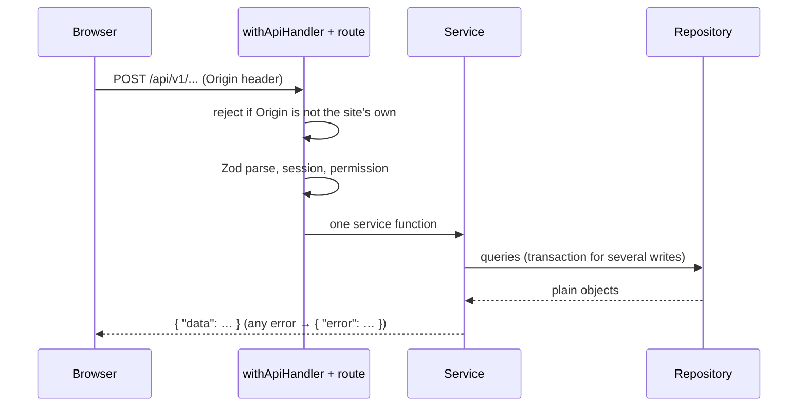

# Architecture

One Next.js application: public website, staff portal (`/portal`) and REST API (`/api/v1`) in the same codebase. All business logic lives in one server-only service layer, so every rule exists in exactly one place.

## Stack and key decisions

| Area       | Choice                                                                                        | Why / consequence                                                                                                                                                              |
| ---------- | --------------------------------------------------------------------------------------------- | ------------------------------------------------------------------------------------------------------------------------------------------------------------------------------ |
| Framework  | Next.js 16.4, App Router, Turbopack, Cache Components on                                      | Data is dynamic by default; public reads opt in to caching                                                                                                                     |
| Language   | TypeScript 6.0 (`strict`, `noUncheckedIndexedAccess`, `noImplicitOverride`)                   | Not 7: `typescript-eslint` supports below 6.1 only. Revisit when it adds support                                                                                               |
| Styling    | Tailwind CSS v4 through `@tailwindcss/postcss`, shadcn/ui on Radix                            | The setup the Next.js docs describe (the starter's `@tailwindcss/turbopack` loader is undocumented)                                                                            |
| Database   | MongoDB 8 + Mongoose 9, as a replica set                                                      | Transactions need a replica set. No Prisma: it does not support MongoDB in its current major version                                                                           |
| Auth       | Better Auth + MongoDB adapter                                                                 | Staff email and password; no public sign-up                                                                                                                                    |
| Validation | Zod 4, shared by forms and API                                                                | One schema validates in the form and again in the API                                                                                                                          |
| Tooling    | npm, Node 24, ESLint 9 (strict type-checked), Prettier, Knip, Husky, Vitest, Playwright + axe | Knip enforces "no unused code"; dependencies are added only when used. ESLint 9, not 10: `eslint-plugin-import` crashes on ESLint 10 whenever it reports an import-order error |
| Logging    | pino                                                                                          | Server only; never logs secrets or personal documents                                                                                                                          |

Later phases add Cloudinary, Nodemailer with React Email, Tiptap, TanStack Query and Table, React Hook Form and Turnstile (see the project brief).

Decisions with consequences:

- **One service layer and one API.** Every client-side read and write goes through `/api/v1`; there are no Server Actions for data changes. Server Components call services directly and never call the app's own API over HTTP.
- **`mongodb` is a direct dependency** (it is the peer dependency of Better Auth's Mongo adapter), so Mongoose and the adapter share one driver copy and Better Auth can reuse Mongoose's client for transactions.
- **npm** with a committed `package-lock.json`. Install scripts are allow-listed in `package.json` (`allowScripts`): `esbuild` and `mongodb-memory-server` run, `fsevents` does not.
- **shadcn components import `cn` from the `cn` package** (not from `src/lib/utils.ts`). `src/components/ui/` and `src/hooks/use-mobile.ts` are CLI output: ESLint skips them and Knip ignores their unused exports, but Prettier and TypeScript still check them.

## Layers

```text
Client components (portal screens, public forms)
   │  typed API client + TanStack Query            (portal, from Phase 5)
   ▼
Route handlers   src/app/api/v1/**/route.ts        parse → authenticate → authorize → call service → respond
   ▼
Services         src/server/services/*.ts          rules, permissions, transactions, audit log, cache invalidation
   ▼
Repositories     src/server/repositories/*.ts      Mongoose queries only; return plain objects
   ▼
MongoDB          models in src/server/db/models/
```

1. Route handlers parse params and body with Zod, load the session, check the permission, call one service function and return the standard response. No Mongoose in routes, pages or components.
2. Services take a typed context (acting user, role, office) plus validated input. They enforce rules, run multi-document writes in a transaction, write an audit entry per change and invalidate cache tags.
3. Only repositories import Mongoose models. They use `.lean()`, select only needed fields and return plain objects with `id` as a string.
4. Every file under `src/server/` starts with `import "server-only"`.



## HTTP layer

- `withApiHandler()` (`src/server/http/handler.ts`) wraps every route handler. It rejects `POST`, `PUT`, `PATCH` and `DELETE` whose `Origin` is not `NEXT_PUBLIC_SITE_URL`'s origin, and maps typed `AppError`s and Zod errors to the standard format. Unexpected errors are logged and returned as a generic `INTERNAL_ERROR`.
- Success `{ "data": … }` (lists add `"meta": { "page", "pageSize", "total" }`). Error `{ "error": { "code", "message", "details": { "fieldErrors" } } }`.

| Code               | Status | Code                | Status |
| ------------------ | ------ | ------------------- | ------ |
| `VALIDATION_ERROR` | 400    | `CONFLICT`          | 409    |
| `UNAUTHORIZED`     | 401    | `PAYLOAD_TOO_LARGE` | 413    |
| `FORBIDDEN`        | 403    | `RATE_LIMITED`      | 429    |
| `NOT_FOUND`        | 404    | `INTERNAL_ERROR`    | 500    |

- **Connection:** one Mongoose connection cached on `globalThis` (no new connection per hot reload), `sanitizeFilter` on (request input can never inject query operators), `autoIndex` off in production.
- **Caching:** public service reads use `"use cache"` with `cacheLife` and `cacheTag` (settings: tag `settings`, hours), invalidated after writes. **Invalidation:** this app writes through route handlers, where `updateTag` is not available (it works only in Server Actions). A service that changes content calls `revalidateTag(tag, { expire: 0 })` (tags in `src/lib/constants/cache-tags.ts`) after the write commits, so the next page view is a cache miss and staff see their change at once. A component that reads them calls `await connection()` first and sits in a `<Suspense>`, so the data is fetched at request time and `npm run build` never needs a database. Portal data is per-user and never cached on the server.
- **Public pages:** a page is a static shell (banner, header, footer) plus content components that call `await connection()` and a cached service, inside `<Suspense>`. Filters and paging come from URL search params, parsed by `src/lib/validations/list-params.ts` (bad values are ignored). An unknown slug renders the not-found page with `noindex` and status 200, because the shell has already been sent. The header navigation is part of the shell; the highlighted item is a style rule streamed in by `ActiveNavStyle`, because reading the path inside the nav would stream the whole nav after the footer.
- **Environment:** `src/env.ts` validates variables with Zod; `next.config.ts` runs it on every start and build, so the app refuses to run with a bad variable.

## Folder structure

```text
.github/workflows/ci.yml      format, lint, typecheck, knip, tests, build, audit, e2e
.husky/pre-commit             lint-staged
docs/                         five documents, plus reference/ (client files, kept until design sign-off)
public/brand/                 OEDF logos only
scripts/                      seed.ts, sync-indexes.ts
src/
  app/                        (site)/ (layout, home, error), portal/(dashboard)/, api/auth/[...all], api/v1/health, not-found, global-error, layout, globals.css, icons
  components/                 ui/ (shadcn), shared/, site/ (header, footer, cards), portal/
  features/                   one folder per public page group: home, about, governance, departments, programs, institutions, careers, research, news, faqs, contact, admissions, legal
  content/                    typed draft copy (home, about, governance, admissions, legal)
  hooks/                      use-mobile.ts (shadcn)
  lib/                        constants/ (enums, departments, site, navigation, labels, cache-tags), validations/ (list-params), seo, structured-data, og-image, format, query-string, auth-client
  server/
    auth/                     auth.ts (Better Auth), session.ts (requireSession)
    db/                       connection.ts, define-model.ts, models/ (one per collection, all-models.ts, shared.schema.ts)
    http/                     handler.ts, errors.ts, responses.ts
    lib/logger.ts
    repositories/  services/
  env.ts
tests/                        e2e/, global-setup.ts (one in-memory replica set), setup.ts (per-file database)
```

- Used by one feature: `src/features/<feature>/`; by two or more: `src/components/shared/` (generic) or `src/components/site/` (public-site specific, such as cards). `src/components/ui/` holds only shadcn CLI output; change looks through tokens and `cva` variants, or wrap in `shared/`.
- Route files stay short: load data, compose components. Unit tests sit next to the file they test. Alias `@/` is `src/`. No barrel `index.ts` (`all-models.ts` is a list for the index script and its test, not a barrel).
- Only `src/server/storage/cloudinary.ts` will talk to the Cloudinary SDK.
- Planned: `src/lib/api/` and `src/providers/` (Phase 5), `src/server/email/`, `storage/`, `security/` (Phase 4), `src/proxy.ts` (Phase 5).
- `globals.css` imports `tw-animate-css` and `shadcn/tailwind.css` (dev dependencies) for the animated shadcn components. The shared gold button is `CtaButton`, a variant wrapper in `shared/`.

## Auth and permissions

Staff sign in with email and password; Better Auth serves `/api/auth/*`. Public sign-up is disabled.

| Setting             | Value                                                                                                                   |
| ------------------- | ----------------------------------------------------------------------------------------------------------------------- |
| Minimum password    | 12 characters, also on admin-created accounts (a before-hook adds this: the admin `createUser` only checks the maximum) |
| Sign-in rate limit  | 5 attempts per minute, then `429`                                                                                       |
| Session cookie      | `HttpOnly`, `SameSite=Lax`, `Secure` in production, 7 days                                                              |
| Cross-site requests | A request with a session cookie from another origin gets `403`                                                          |
| Accounts            | Created by Super Admin only; deactivated (banned), never deleted                                                        |

The cookie is `Secure` in production, so over plain `http://localhost` use Chrome or Firefox (Safari rejects it).

| Role          | Who                                   | Scope                                                                 |
| ------------- | ------------------------------------- | --------------------------------------------------------------------- |
| `SUPER_ADMIN` | Technical administrator               | Everything, including users and settings                              |
| `CEO_OFFICE`  | Prof. Omar Farooq and executive staff | Sees all offices, makes final decisions, reads the audit log          |
| `DIRECTOR`    | Head of one office                    | Full control of their office's modules, publishes, makes decisions    |
| `STAFF`       | Office team member                    | Works on their office's items; cannot publish or make final decisions |

- Each user has one role and one office (`departmentId`). Roles are defined once in `ROLES` (`src/lib/constants/enums.ts`); `auth.ts` registers all four with Better Auth's admin plugin (a compile-time check catches a missing one). Only `SUPER_ADMIN` gets the plugin's admin rights. The seeded Super Admin belongs to the Chief Executive Office.
- **Permissions (Phase 5):** strings such as `applications:review`, `vacancies:publish`, `directives:issue` in `src/lib/constants/permissions.ts`, with one role-to-permission map used both to hide buttons and to enforce access. The server re-checks in every protected handler and page (`requireSession()`, `requirePermission(...)`). `src/proxy.ts` only redirects signed-out visitors away from `/portal` and is never a security layer. The module-by-role table is in the project brief (section 8) and is copied here when Phase 5 builds it.

## Coding standards

- **No dead code:** no unused files, exports, components, hooks, dependencies, variables, routes, endpoints or CSS; no commented-out code, `console.log`, `TODO`/`FIXME`, demo pages or abstractions "for later". `npm run knip` reports nothing. (`console.info`, `warn`, `error` are allowed in `scripts/`.)
- **TypeScript:** no `any`, `@ts-ignore` or non-null `!`. Derive types from Zod (`z.infer`) and Mongoose (`InferSchemaType`). Exported service and repository functions declare return types.
- **Naming:** kebab-case files; PascalCase components and types; camelCase functions; UPPER_SNAKE_CASE constants; booleans start with `is`, `has`, `can`, `should`; handlers `handleX`, callback props `onX`; services read verb + noun (`createVacancy`).
- **Shape:** one job per function (about 50 lines) and component (about 150); early returns; no nested ternaries or magic values; handle every promise (`no-floating-promises`); comments explain why, never what.
- **Styling:** theme tokens only (no hex, inline styles or arbitrary values in components); `cn()` to merge classes; Server Components by default.
- **Errors and logs:** throw typed `AppError`s, never swallow; users see friendly messages, logs get detail through pino.
- **Tooling:** ESLint flat config (`next/core-web-vitals`, strict type-checked, `import/order`: builtin, external, `@/`, parent, sibling, alphabetized). One scoped exception: `no-unsafe-class-instance-assignment` is off in `src/server/db/models/` (Mongoose types field options as a class). Prettier with the Tailwind plugin. Husky runs lint-staged on commit.
- **Node ESM:** `package.json` has `"type": "module"` and the `db:*` scripts run in native ESM through `tsx --conditions=react-server` (so `server-only` loads). Mongoose is CommonJS, so use its default import for `models` and `connection`.
- **Git:** Conventional Commits, one logical change per commit, one branch per build phase.
